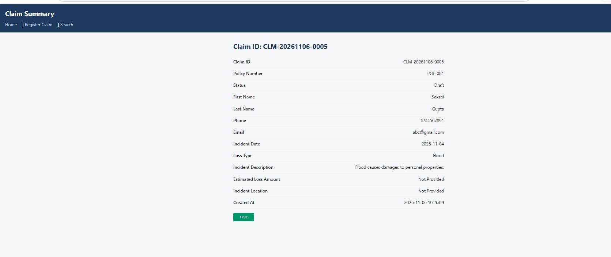

# Insurance Claims Intake

A lightweight Python web app that guides insurance staff and customers through the First Notice of Loss (FNOL) process. Built with FastAPI, SQLite, Jinja2 templates, and vanilla JavaScript.

## Features

- **Register a claim** — multi-step form generates a unique `CLM-YYYYMMDD-NNNN` ID on submit
- **Validate data** — mandatory fields and format rules enforced client-side and server-side
- **Retrieve claims** — search by Claim ID (exact) or last name (partial); max 50 results
- **Claim summary** — read-only view of all fields; missing optional fields show "Not Provided"; printable

## Tech Stack

- Python 3.11+, FastAPI, Pydantic v2, SQLite (stdlib `sqlite3`), Jinja2, python-dotenv
- Vanilla HTML/CSS/JS (no framework, no bundler)
- pytest + hypothesis for testing

## Setup

```bash
pip install -r requirements.txt    # install dependencies
python -m db.seed                   # seed sample policies (optional, auto-runs on startup)
uvicorn main:app --reload           # start server (from PythonClaimsIntake/)
```

Then open http://localhost:8000 in your browser.

## Testing

```bash
pytest --tb=short -v                # run all tests
```

Tests use in-memory SQLite (`:memory:`) and never touch `claims.db`.

## Project Structure

```
PythonClaimsIntake/
  db/              # SQLite schema, database init, seed data, claims repo
  models/           # Pydantic v2 models (no logic, no DB calls)
  middleware/       # Pure validation functions
  routers/          # Thin HTTP handlers (claims, policies)
  templates/        # Jinja2 HTML templates
  static/js/        # Frontend JS modules (api.js is sole fetch file)
  static/css/       # Stylesheet
  tests/            # Unit, property, and integration tests
  main.py           # FastAPI app entry point
```

## Sample Policies (pre-seeded)

| Policy | Holder | Type |
|--------|--------|------|
| POL-001 | Alice Johnson | Home |
| POL-002 | Bob Martinez | Auto |
| POL-003 | Carol Williams | Home |
| POL-004 | David Chen | Commercial |
| POL-005 | Emily Thompson | Life |
| POL-006 | Frank Nguyen | Auto |
| POL-007 | Grace Patel | Home |

## Kiro Capabilities Used

- **Spec-driven development** — requirements.md, design.md, and tasks.md defined the spec
- **Tasks orchestration** — DAG-based task execution with dependency tracking via tasks.md


## Screenshots & Demo

### Home Page


### File a Claim (4-step intake form)


### Claim Summary


### Search Claims


> **To run a live demo:** follow the Setup steps above, then open http://localhost:8000 in your browser.
> Use any of the pre-seeded policy numbers (POL-001 through POL-007) to file a claim.


## Screenshots & Demo

### Home Page


### File a Claim (4-step intake form)


### Claim Summary


### Search Claims


> **Live demo:** start the server with the setup steps above, then open http://localhost:8000.
> Use any pre-seeded policy number (POL-001 through POL-007) to file a claim.
